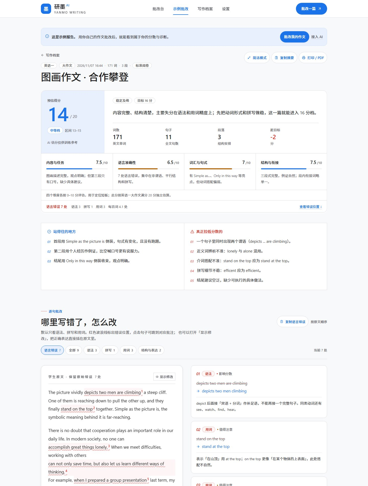

# 研墨 AI（YanMo）

面向考研英语一 / 英语二的手写作文批改工具。

上传手写作文照片，或直接粘贴文字稿，研墨会按考研写作的评分维度给出估分、逐句修改建议、段落改写、参考范文和下一轮练习。批改报告会进入本机写作档案，常见错误会汇总到错题本，可以按类型筛选并遮住答案重做。

> 评分仅用于训练参考，不能替代正式考试阅卷。

## 预览





## 功能

- **手写识别 + 人工核对**：手机拍摄或拖入图片，先 OCR 成文字，逐字核对后再评分，避免把识别错误算成写作错误。
- **题目图片识别**：可直接上传作文题目、图画或图表，自动整理成题干并填入题目要求；识别结果可修改，题型可自动匹配。
- **对标考研阅卷**：区分英语一 / 英语二、小作文 / 大作文，按内容任务、语言准确、词汇句式、结构衔接四个维度给分。
- **逐句语言纠错**：优先、完整扫描语法、拼写、用词/搭配错误，按原文顺序编号。原文红色波浪线标出错误位置，可只看「语法 / 拼写 / 用词」，也可一键把正确表达插在原文中，或复制语言错误清单。
- **简洁模式**：报告顶部一键切换，隐藏优点/问题分析、段落重写、参考范文和训练清单，只保留估分、语言错误与精简建议；开关状态会记住。
- **段落改写与参考范文**：保留原意的段落改写 + 高分范文，并解释范文亮点，不鼓励整篇背诵。
- **下一步练习**：结合个人水平、目标分和本机历史高频错误，生成 2–3 条建议与可执行的练习清单。
- **写作档案**：分数趋势、错误类型分布、按题目/试卷/题型搜索、逐篇回看；支持导入导出 JSON 备份。
- **草稿自动保存**：批改台的作文内容、题目和设置会自动保存在本机，刷新或重新打开后可恢复。
- **移动端导航**：手机上面板菜单可以直接进入批改台、错题本、写作档案和设置。
- **错题本**：汇总历次批改中的错误，按类型筛选、标出重复错误；支持练习模式，先自己改再对照参考答案。
- **提交前自查**：批改前检查词数、段落、长句、常见拼写错误和重复用词，并提供可勾选的自查清单。
- **报告练习模式**：逐句隐藏参考答案，先写下自己的修改，再对照建议和解释。
- **自带 AI**：在页面填写任意 OpenAI Chat Completions 兼容接口的 Base URL、模型 ID 与 API Key，不限制服务商；也支持服务端 `.env.local`。

## 快速开始

普通用户推荐使用 **Windows 桌面版** 或 **绿色便携版**，双击即可，不需要安装 Node.js。
开发者或想修改代码时，使用源码启动方式（需要 Node.js 18.17+，推荐 20+）。

### 方式一：Windows 桌面版（Electron，推荐）

1. 从 [GitHub Releases](https://github.com/initialize-ye/YanMo/releases/latest) 下载 `YanMo-*-win64.exe`。
2. 双击运行，会打开独立窗口，不再需要浏览器或 Node.js。
3. 首次使用在页面「设置」里填写 AI 接口信息。

桌面版说明：

- 程序内部会启动一个只监听 `127.0.0.1:38217` 的本地服务，再加载应用界面。
- 报告和设置在 `%APPDATA%\YanMo` 中持久保存；升级程序不会丢失。
- 未签名的 exe 首次运行可能出现 SmartScreen 提示，点击「更多信息 → 仍要运行」即可。
- 桌面版和绿色包的界面、功能、数据格式一致，但两者使用各自独立的本地数据目录。

### 方式二：绿色便携版（Windows，免安装）

1. 获取 `yanmo-portable-win64.zip`：
   - 直接下载：[GitHub Releases](https://github.com/initialize-ye/YanMo/releases/latest)；
   - 或由维护者运行 `npm run build:portable` 生成，文件位于 `dist/yanmo-portable-win64.zip`；
   - 或在 GitHub Actions 中手动运行 **Build Windows Packages** 工作流，下载生成的 Artifact。
2. 把 zip 完整解压到任意目录（例如 `D:\YanMo`）。
3. 双击 **`启动研墨.cmd`**。
4. 浏览器自动打开；首次使用在页面「设置」里填写 AI 接口信息即可。

绿色包已内置 Node.js 运行环境，不需要安装任何软件。作文和报告仍只保存在本机浏览器中。

> 如果 Windows 提示“Windows 已保护你的电脑”，点击「更多信息 → 仍要运行」。
> 这是未签名的 `node.exe` 触发的 SmartScreen 提示，不是程序损坏。

### 方式三：双击启动（Windows，开发模式）

适合已安装 Node.js、需要修改代码的用户。直接双击项目根目录的 **`启动项目.cmd`**（或 `启动项目.ps1`）。

- 会打开一个 PowerShell 窗口，显示启动过程和错误提示。
- 首次运行会自动 `npm install`；服务就绪后自动打开浏览器。
- 出现任何错误时窗口不会立刻关闭，会停留等待回车，方便查看原因。

命令行方式（可选参数：`-Port` 指定端口，`-NoBrowser` 不自动打开浏览器）：

```powershell
PowerShell -ExecutionPolicy Bypass -File .\启动项目.ps1
PowerShell -ExecutionPolicy Bypass -File .\启动项目.ps1 -Port 3001 -NoBrowser
```

### 方式四：手动启动

```powershell
npm install
npm run dev
```

打开 http://localhost:3000。

### 打包 / 分发

**Windows 桌面版（Electron）**

```powershell
npm install
npm run build:exe
```

输出：

```text
dist-electron/YanMo-<version>-win64.exe
```

构建过程会：

1. 用 Next.js standalone 模式构建应用；
2. 把静态资源复制进 standalone 目录；
3. 用 Electron 封装成本地窗口程序；
4. 通过 `afterPack` 钩子补齐 standalone 服务的精简 `node_modules`；
5. 生成单文件 Windows portable exe。

桌面版固定使用本机端口 `38217`，只监听 `127.0.0.1`；数据保存在 `%APPDATA%\YanMo`。

**绿色便携版（Windows，免安装）**

维护者执行：

```powershell
npm run build:portable
```

脚本会：

1. 使用 Next.js standalone 模式构建；
2. 优先下载 Windows x64 便携版 Node.js 并打包进 `runtime/`；下载失败时自动使用本机 Node.js；
3. 复制静态资源、启动器和使用说明；
4. 生成 `dist/yanmo-portable-win64.zip`（zip 内含顶层文件夹，解压后不会散落）。

GitHub Actions 中提供了 **Build Windows Packages** 工作流，可手动运行并下载桌面版 exe 和绿色包 Artifact；推送 `v*` 标签时也会自动附加到 Release。

## 接入 AI

手写识别与题目图片识别需要**支持图片输入**的模型。批改只需要文本模型，但为了少配置一项，默认使用同一个视觉模型完成识别与批改。

### 方式 A：页面里配置（最快）

1. 打开 `/settings`。
2. 在「自定义接口」中填写接口地址、模型名称和 API Key。
3. 点击「保存并测试连接」。
4. 回到 `/grade` 开始批改。

Key 保存在浏览器 localStorage，只在发起批改时发送到本机 API，再转发给对应服务商。适合本机个人使用；公开部署请改用方式 B。

页面只提供「自定义接口」，不内置服务商选项。填写示例（仅作参考）：

- DeepSeek Flash：`https://api.deepseek.com`，模型 `deepseek-flash`
- 通义千问 VL：`https://dashscope.aliyuncs.com/compatible-mode/v1`，模型 `qwen-vl-max-latest`
- OpenAI：`https://api.openai.com/v1`，模型 `gpt-4o-mini`
- 本地 Ollama：`http://localhost:11434/v1`，模型按本地已拉取的模型填写

模型名称会随服务商更新，若提示「模型不存在」，请在对应服务商文档中确认模型 ID 后重新填写。

**DeepSeek Flash 的思考模式**：`deepseek-flash` 默认先输出 `reasoning_content`，再输出最终答案 `content`。如果输出预算太小，`content` 可能为空。本项目在官方 DeepSeek 接口上自动发送 `thinking: { type: "disabled" }`，保证连接测试、手写识别和批改都能拿到最终内容；使用其他网关时，请确认它支持并透传该字段，或换用非思考模型。

### 方式 B：服务端环境变量（推荐长期使用）

```powershell
Copy-Item .env.example .env.local
```

编辑 `.env.local`：

```dotenv
AI_API_KEY=sk-xxxxxxxx
AI_BASE_URL=https://dashscope.aliyuncs.com/compatible-mode/v1
AI_MODEL=qwen-vl-max-latest
```

可选拆分模型：

```dotenv
AI_VISION_MODEL=qwen-vl-max-latest
AI_TEXT_MODEL=qwen-plus
```

修改 `.env.local` 后需要重启开发服务器。浏览器中的配置优先级高于环境变量。

### 关于接口安全

- 浏览器配置会通过请求头把 Key 发送到本机 `/api/ocr`、`/api/topic`、`/api/grade`，再由服务端转发给服务商。
- 服务端只接受 `https` 公网地址；`http` 仅允许 localhost，便于接入本地 Ollama 等兼容服务。
- 本项目没有登录与权限系统，BYOK 设计面向个人本机使用。如果要公开部署，请只使用服务端 Key，并考虑给 API 增加鉴权、限流与域名白名单。

## 写作档案备份

在 `/history` 顶部可以：

- **导出**：下载 JSON 备份，包含全部报告和个人设置，不包含 API Key。
- **导入**：选择备份文件后先显示预览（可新增多少篇、跳过多少重复），确认后再合并。合并按报告 id 去重，本机已有记录不会被修改或删除。

## 工作流程

```
作文图片 → 浏览器压缩（长边 1800px）→ /api/ocr（视觉模型）
       → 识别文本 → 用户核对 / 修改
题目图片 → 浏览器压缩 → /api/topic（视觉模型）→ 题干 / 图表描述 → 自动填入
       → /api/grade（文本模型）→ 结构化 JSON → 校验归一化 → 报告页 + localStorage
```

题目图片识别会把图画/图表转成中文描述，连同英文题干一起放进评分上下文；识别结果可以手动修改。

评分提示词、JSON 字段约束与归一化逻辑在：

- `lib/server/prompt.ts`：作文 OCR、题目识别与批改提示词
- `lib/server/normalize.ts`：分数、批注、建议等字段的校验和兜底
- `lib/server/ai.ts`：OpenAI 兼容调用、超时、错误映射、JSON 模式回退

报告以 `GradeResult` 结构存储，类型定义在 `lib/types.ts`。

## 页面

| 路径 | 说明 |
| --- | --- |
| `/` | 首页、功能说明、评分标准 |
| `/grade` | 批改台：上传 / 文字稿、草稿自动保存、提交前自查、题目识别 → 核对 → 批改 |
| `/report/[id]` | 批改报告：估分、维度、逐句修改、练习模式、段落改写、范文 |
| `/mistakes` | 错题本：错误汇总、类型筛选、重复错误、练习模式 |
| `/history` | 写作档案：趋势、高频错误、搜索、导入导出 |
| `/settings` | AI 接入、个人水平、数据导出与清理 |

## 项目结构

```
app/
  api/ocr/route.ts        手写图片 → 文字
  api/topic/route.ts      题目图片 → 题干 / 图画图表描述
  api/grade/route.ts      文字 → 批改报告
  api/ai/test/route.ts    测试 AI 连接
  api/status/route.ts     查询服务端是否配置 AI
  grade/page.tsx          批改流程
  report/[id]/page.tsx    报告页
  mistakes/page.tsx       错题本
  history/page.tsx        写作档案
  settings/page.tsx       AI 与个人设置
components/
  report/                 原文批注、段落重写
  self-check.tsx          提交前自查
  site-header.tsx         ...
electron/
  main.cjs                桌面版主进程：启动本地服务、创建窗口
build/
  icon.ico                应用图标
scripts/
  build-portable.ps1      绿色便携包构建
  prepare-standalone.mjs  复制静态资源到 standalone
  after-pack.cjs          把服务端 node_modules 补进 Electron 包
electron-builder.yml      Windows exe 打包配置
lib/
  server/                 仅服务端：提示词、AI 调用、校验
  constants.ts            题型、分值、水平、真题训练题
  mistakes.ts             汇总错题、统计重复错误
  self-check.ts           词数、长句、拼写与重复用词检查
  sample.ts               快速测试用样文
  storage.ts              localStorage 档案与配置
  image.ts                图片压缩
```

## 数据与隐私

- 报告、个人水平设置和 AI 配置默认保存在浏览器 localStorage，不会写入数据库。
- Windows 桌面版使用 Electron 的持久化存储，数据位于 `%APPDATA%\YanMo`；绿色包和源码版使用浏览器 localStorage。
- 图片只在识别时上传到你配置的 AI 服务；研墨不做对象存储，也不保留原图。
- 报告最多保留 100 篇；可在写作档案页导入 / 导出 JSON 备份，或在设置页清除全部报告。
- 绿色包/浏览器版清除站点数据、更换浏览器或无痕模式会导致档案丢失；桌面版不要手动删除 `%APPDATA%\YanMo`。

## 开发脚本

```bash
npm run dev                 # 开发服务器
npm run build               # 生产构建（Next.js standalone）
npm run start               # 启动生产构建
npm run typecheck           # TypeScript 检查
npm run prepare:standalone  # 把静态资源复制进 .next/standalone
npm run electron:dev        # 以 Electron 窗口运行已构建的应用
npm run build:exe           # 构建 Windows 桌面版 exe
npm run build:exe:dir       # 只生成未打包的 Electron 目录，便于调试
```

## 常见问题

**双击启动脚本后窗口闪退、项目没起来**
现在双击 `启动项目.cmd` 或 `启动项目.ps1` 都会保留窗口：出错时窗口会停住并显示原因，按回车才关闭。
常见原因是脚本编码或执行策略问题，当前版本已修复：脚本保存为带 BOM 的 UTF-8，内部改用 `npm.cmd` 调用，并在外层捕获异常。

**双击 .ps1 时提示「禁止运行脚本」**
Windows 默认按「安全相关文件」打开 `.ps1`。请双击 `启动项目.cmd`，或在 PowerShell 中执行：
```powershell
PowerShell -ExecutionPolicy Bypass -File .\启动项目.ps1
```

**Node.js 版本过低或找不到 node**
脚本会直接提示并停住。安装 Node.js 20 LTS 后重新双击即可。

**端口 3000 被占用**
说明已经有一个实例在运行，脚本会直接打开 `http://localhost:3000`。需要新开一个实例时使用：
```powershell
PowerShell -ExecutionPolicy Bypass -File .\启动项目.ps1 -Port 3001
```

**桌面版提示端口 38217 被占用**
桌面版固定使用 `127.0.0.1:38217`。请先关闭已经运行的研墨窗口，或在任务管理器结束残留的 `YanMo.exe` 后重试。不要随意修改端口，否则 Electron 会把它当成新的站点，之前的本地数据不会自动出现。

**桌面版数据在哪里**
位于 `%APPDATA%\YanMo`。升级 exe 一般不会删除这里；卸载或手动清理该目录才会丢失报告和设置。

**提示「还没有接入 AI」**
到 `/settings` 填写 Key，或配置 `.env.local` 后重启。

**401 / 403**
Key 无效、过期，或没有该模型权限。

**402 / 余额不足**
DeepSeek 等服务商会用 402 表示账户余额或额度不足。到服务商控制台充值后重试。现在界面会直接显示“AI 账户余额不足”，不再只显示笼统的“服务暂时不可用”。

**429 / 限流**
请求过于频繁，等待几十秒后重试；也可能是账户额度已用完。

**502 / 503 / 服务暂时不可用**
上游服务临时故障或网络中断。项目会自动重试一次；仍失败时，界面会显示上游状态码和错误详情。DeepSeek 503 通常等待一段时间即可恢复。

**桌面版日志在哪里**
`%APPDATA%\YanMo\logs\server.log`。遇到启动或接口异常时，把这个文件尾部发来即可定位。

**404 / 模型不存在**
检查 Base URL 是否保留 `/v1`、`/v4` 等版本路径，以及模型名称是否拼写正确。

**400，或提示不支持图片**
当前模型不支持视觉输入。换一个视觉模型，或改用「文字稿」模式。

**超时**
默认超时 120 秒。可重试，或在设置中换响应更快的模型。

**图片上传失败**
确认是 JPG / PNG / WebP，且不超过 15 MB。HEIC 需要先在手机相册里转换格式。

**批改结果格式错误**
部分模型不擅长严格 JSON。项目会自动尝试关闭 `response_format` 重试；仍失败时，换用指令遵循更好的模型（如 Qwen / GPT-4o / Gemini）。

**提示「AI 返回了空内容」或 `finish_reason=length`**
常见于默认开启思考模式的模型（例如 DeepSeek Flash）。模型把输出预算花在了 `reasoning_content` 上，`content` 为空。
官方 DeepSeek 接口会自动关闭思考模式；其他网关请关闭 thinking/reasoning，或换用非思考模型。

## 部署提示

- 生产环境请在服务端设置 `AI_API_KEY`，不要把 Key 暴露给浏览器。
- `/api/ocr`、`/api/topic` 与 `/api/grade` 设置了 `maxDuration = 120`，部署平台的函数时长和请求体大小需要相应放宽（部分平台默认 4.5 MB）。
- 当前档案存储在浏览器，没有跨设备同步；需要多端同步时应接入数据库与登录。

## 技术栈

Next.js 14（App Router）· React 18 · TypeScript · Tailwind CSS · lucide-react · OpenAI 兼容 Chat Completions API

---

© 2026 研墨 YANMO · 为考研写作而做
