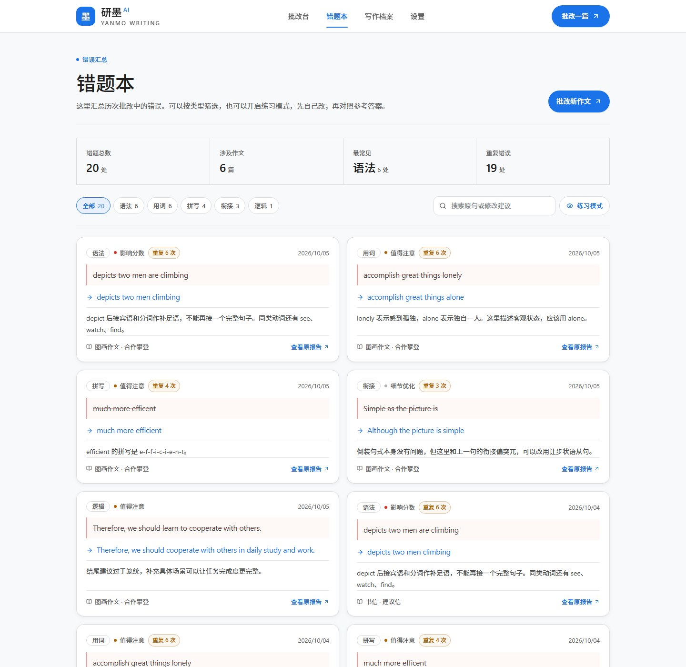

# 研墨 AI（YanMo）

面向考研英语一 / 英语二的手写作文批改工具。

上传手写作文照片，或直接粘贴文字稿，研墨会按考研写作的评分维度给出估分、逐句修改建议、段落改写、参考范文和下一轮练习。批改报告会进入账号下的写作档案，常见错误会汇总到错题本，可以按类型筛选并遮住答案重做。

> 评分仅用于训练参考，不能替代正式考试阅卷。

## 预览




## 功能

- **手写识别 + 人工核对**：手机拍摄或拖入图片，先 OCR 成文字，逐字核对后再评分，避免把识别错误算成写作错误。
- **题目图片识别**：可直接上传作文题目、图画或图表，自动整理成题干并填入题目要求；识别结果可修改，题型可自动匹配。
- **对标考研阅卷**：区分英语一 / 英语二、小作文 / 大作文，按内容任务、语言准确、词汇句式、结构衔接四个维度给分。
- **逐句语言纠错**：优先、完整扫描语法、拼写、用词/搭配错误，按原文顺序编号。原文红色波浪线标出错误位置，可只看「语法 / 拼写 / 用词」，也可一键把正确表达插在原文中，或复制语言错误清单。
- **简洁模式**：报告顶部一键切换，隐藏优点/问题分析、段落重写、参考范文和训练清单，只保留估分、语言错误与精简建议；开关状态会记住。
- **段落改写与参考范文**：保留原意的段落改写 + 高分范文，并解释范文亮点，不鼓励整篇背诵。
- **下一步练习**：结合个人水平、目标分和账号下的历史高频错误，生成 2–3 条建议与可执行的练习清单。
- **写作档案**：分数趋势、错误类型分布、按题目/试卷/题型搜索、逐篇回看；支持导入导出 JSON 备份。
- **草稿自动保存**：批改台的作文内容、题目和设置会自动保存在本机，刷新或重新打开后可恢复。
- **移动端导航**：手机上面板菜单可以直接进入批改台、错题本、写作档案和设置。
- **错题本**：汇总历次批改中的错误，按类型筛选、标出重复错误；支持练习模式，先自己改再对照参考答案。
- **提交前自查**：批改前检查词数、段落、长句、常见拼写错误和重复用词，并提供可勾选的自查清单。
- **报告练习模式**：逐句隐藏参考答案，先写下自己的修改，再对照建议和解释。
- **自带 AI**：在页面填写任意 OpenAI Chat Completions 兼容接口的 Base URL、模型 ID 与 API Key，不限制服务商；也支持服务端 `.env.local`。

## 快速开始

研墨是带账号的 Web 应用：打开后先注册 / 登录，报告与个人设置按账号保存在服务器；未登录访问受保护页面会跳转到 `/login`。

### 部署 / 自建

见 **[deploy/README.md](deploy/README.md)**（Ubuntu + Nginx + HTTPS + systemd 一键脚本）。

### 本地开发

```bash
npm install
npm run dev
```

打开 http://localhost:3000 ，注册一个账号即可开始。生产构建：

```bash
npm run build
npm run prepare:standalone
YANMO_DATA_DIR=./data PORT=3000 node .next/standalone/server.js
```

### 账号与数据

- 邮箱 + 密码注册登录，密码以 scrypt 加盐哈希保存，会话为 HttpOnly Cookie。
- 批改报告、个人设置按账号存储在服务器（`YANMO_DATA_DIR`，默认 `./data`），换设备登录同一账号即可看到。
- AI Key 由用户各自在「设置」页填写，只保存在本机浏览器，不上传服务器。
- 支持导出 / 导入整份档案 JSON 作为离线备份。

## 接入 AI

手写识别与题目图片识别需要**支持图片输入**的模型。批改只需要文本模型，但为了少配置一项，默认使用同一个视觉模型完成识别与批改。

### 方式 A：页面里配置（最快）

1. 打开 `/settings`。
2. 在「自定义接口」中填写接口地址、模型名称和 API Key。
3. 点击「保存并测试连接」。
4. 回到 `/grade` 开始批改。

Key 保存在浏览器 localStorage，只在发起批改时发送到本机 API，再转发给对应服务商。适合本机个人使用；公开部署请改用方式 B。

页面只提供「自定义接口」，不内置服务商选项。填写示例（仅作参考）：

- DeepSeek Flash：`https://api.deepseek.com`，模型 `deepseek-flash`
- 通义千问 VL：`https://dashscope.aliyuncs.com/compatible-mode/v1`，模型 `qwen-vl-max-latest`
- OpenAI：`https://api.openai.com/v1`，模型 `gpt-4o-mini`
- 本地 Ollama：`http://localhost:11434/v1`，模型按本地已拉取的模型填写

模型名称会随服务商更新，若提示「模型不存在」，请在对应服务商文档中确认模型 ID 后重新填写。

**DeepSeek Flash 的思考模式**：`deepseek-flash` 默认先输出 `reasoning_content`，再输出最终答案 `content`。如果输出预算太小，`content` 可能为空。本项目在官方 DeepSeek 接口上自动发送 `thinking: { type: "disabled" }`，保证连接测试、手写识别和批改都能拿到最终内容；使用其他网关时，请确认它支持并透传该字段，或换用非思考模型。

### 方式 B：服务端环境变量（推荐长期使用）

```powershell
Copy-Item .env.example .env.local
```

编辑 `.env.local`：

```dotenv
AI_API_KEY=sk-xxxxxxxx
AI_BASE_URL=https://dashscope.aliyuncs.com/compatible-mode/v1
AI_MODEL=qwen-vl-max-latest
```

可选拆分模型：

```dotenv
AI_VISION_MODEL=qwen-vl-max-latest
AI_TEXT_MODEL=qwen-plus
```

修改 `.env.local` 后需要重启开发服务器。浏览器中的配置优先级高于环境变量。

### 关于接口安全

- 浏览器配置会通过请求头把 Key 发送到 `/api/ocr`、`/api/topic`、`/api/grade`，再由服务端转发给服务商。
- 服务端只接受 `https` 公网地址；`http` 仅允许 localhost，便于接入本地 Ollama 等兼容服务。
- `/api/ocr`、`/api/topic`、`/api/grade`、`/api/ai/test` 都要求登录：使用服务端 `AI_API_KEY` 时，登录是防止额度被匿名消耗的应用层防线。
- 公开部署时仍建议在 Nginx 层对 `/api/` 做限流与域名白名单，模板见 `deploy/nginx/yanmo.conf`。

## 写作档案备份

在 `/history` 顶部可以：

- **导出**：下载 JSON 备份，包含全部报告和个人设置，不包含 API Key。
- **导入**：选择备份文件后先显示预览（可新增多少篇、跳过多少重复），确认后再合并。合并按报告 id 去重，账号下已有记录不会被修改或删除。

## 工作流程

```
作文图片 → 浏览器压缩（长边 1800px）→ /api/ocr（视觉模型）
       → 识别文本 → 用户核对 / 修改
题目图片 → 浏览器压缩 → /api/topic（视觉模型）→ 题干 / 图表描述 → 自动填入
       → /api/grade（文本模型）→ 结构化 JSON → 校验归一化 → 报告页 + localStorage
```

题目图片识别会把图画/图表转成中文描述，连同英文题干一起放进评分上下文；识别结果可以手动修改。

评分提示词、JSON 字段约束与归一化逻辑在：

- `lib/server/prompt.ts`：作文 OCR、题目识别与批改提示词
- `lib/server/normalize.ts`：分数、批注、建议等字段的校验和兜底
- `lib/server/ai.ts`：OpenAI 兼容调用、超时、错误映射、JSON 模式回退

报告以 `GradeResult` 结构存储，类型定义在 `lib/types.ts`。

## 页面

| 路径 | 说明 |
| --- | --- |
| `/` | 首页、功能说明、评分标准 |
| `/grade` | 批改台：上传 / 文字稿、草稿自动保存、提交前自查、题目识别 → 核对 → 批改 |
| `/report/[id]` | 批改报告：估分、维度、逐句修改、练习模式、段落改写、范文 |
| `/mistakes` | 错题本：错误汇总、类型筛选、重复错误、练习模式 |
| `/history` | 写作档案：趋势、高频错误、搜索、导入导出 |
| `/settings` | AI 接入、个人水平、数据导出与清理 |

## 项目结构

```
app/
  login/page.tsx          登录 / 注册
  api/auth/               注册、登录、登出、当前用户
  api/reports/            报告读取/新增/删除、单篇读取、批量导入
  api/profile/            个人设置读取/保存
  api/ocr|topic|grade     手写识别、题目识别、批改（均需登录）
  api/ai/test             连接测试
  middleware.ts           未登录访问受保护页面时跳转 /login
  grade/page.tsx          批改流程
  report/[id]/page.tsx    报告页
  mistakes/page.tsx       错题本
  history/page.tsx        写作档案
  settings/page.tsx       AI 与个人设置
  manifest.ts             PWA manifest
lib/
  server/store.ts         用户/会话/报告/资料的服务器端存储（文件型，原子写）
  server/auth.ts          会话 Cookie、当前用户
  server/report.ts        报告落盘前的结构校验（版本、长度、条数、体积）
  server/validate.ts      请求参数校验
  user-data.ts            浏览器端数据层（调用上述接口，401 交给 SessionGuard）
  client-api.ts           AI 接口调用封装（OCR / 题目 / 批改 / 测试）
  storage.ts              仅本地：AI Key、简洁模式、草稿、备份解析
  mistakes.ts             错题汇总
  self-check.ts           提交前自查
  image.ts                图片压缩与预处理
  utils.ts                格式化、统计、批注定位
components/               页面组件（报告批注、自查、头部/底部、会话守卫等）
  report/                 报告页专用（逐句批注、段落改写）
deploy/                   服务器部署：Nginx、systemd、脚本、手册
docs/                     代码审计报告与预览图
```

## 数据与隐私

- 账号：邮箱 + 密码，密码以 scrypt 加盐哈希保存；会话为 HttpOnly Cookie。
- 报告与个人设置按用户存储在服务器 `YANMO_DATA_DIR`（默认 `./data`），不同账号互相隔离。
- AI 接口 Key 只保存在用户本机浏览器 localStorage，不上传服务器；作文图片仅在识别时发送到你配置的 AI 服务。
- 每个账号最多保留 100 篇报告；可在写作档案页导入 / 导出 JSON 备份，或在设置页清除全部报告。

## 开发脚本

```bash
npm run dev                 # 开发服务器
npm run dev:clean           # 先清理 .next 再启动开发服务器
npm run clean               # 清理 .next 与 tsconfig.tsbuildinfo
npm run build               # 生产构建（Next.js standalone）
npm run start               # 生产模式启动（standalone）
npm run typecheck           # TypeScript 检查
npm run lint                # ESLint 检查
npm run prepare:standalone  # 把静态资源复制进 .next/standalone
```

## 常见问题

**双击启动脚本后窗口闪退、项目没起来**
`启动项目.cmd` / `启动项目.ps1` 出错时会停住并显示原因，按回车才关闭；请先安装 Node.js 20 LTS。

**页面显示旧内容 / 开发时报 hydration 不一致**
多为缓存导致，`npm run clean && npm run dev`，或在浏览器按 `Ctrl+Shift+R` 硬刷新。

**提示「还没有接入 AI」**
到 `/settings` 填写 Key，或配置服务端 `AI_API_KEY` 环境变量后重启。

**401 / 403**：Key 无效、过期或无该模型权限。
**402 / 余额不足**：到服务商控制台充值后重试。
**429 / 限流**：请求过于频繁或额度用完，稍候再试。
**502 / 503**：上游临时故障，通常稍后恢复。
**404 / 模型不存在**：检查 Base URL 的版本路径（`/v1` 等）与模型名。
**400 / 不支持图片**：当前模型不支持视觉输入，换视觉模型或改用文字稿。
**超时**：默认 120 秒，可重试或换更快的模型。
**图片上传失败**：确认 JPG / PNG / WebP 且 < 15MB，HEIC 需先转格式。
**批改结果格式错误**：换指令遵循更好的模型（Qwen / GPT-4o / Gemini）。
**「AI 返回了空内容」**：多为思考模式模型耗尽输出预算，关闭 thinking 或换非思考模型。

## 部署提示

- 生产环境可用服务端 `AI_API_KEY` 统一代理，或让用户自带 Key（存本机）。
- `/api/ocr`、`/api/topic`、`/api/grade` 的 `maxDuration = 120`，请在反向代理放宽超时与请求体大小（照片 base64 约 12MB）。
- Nginx 对 `/api/` 与 `/api/auth/*` 做限流，防刷与防爆破；模板见 `deploy/nginx/yanmo.conf`。
- 完整自建方案（Ubuntu + Nginx + HTTPS + systemd + 账号数据存储）见 **[deploy/README.md](deploy/README.md)**。

## 技术栈

Next.js 14（App Router）· React 18 · TypeScript · Tailwind CSS · lucide-react · OpenAI 兼容 Chat Completions API

---

© 2026 研墨 YANMO · 为考研写作而做
